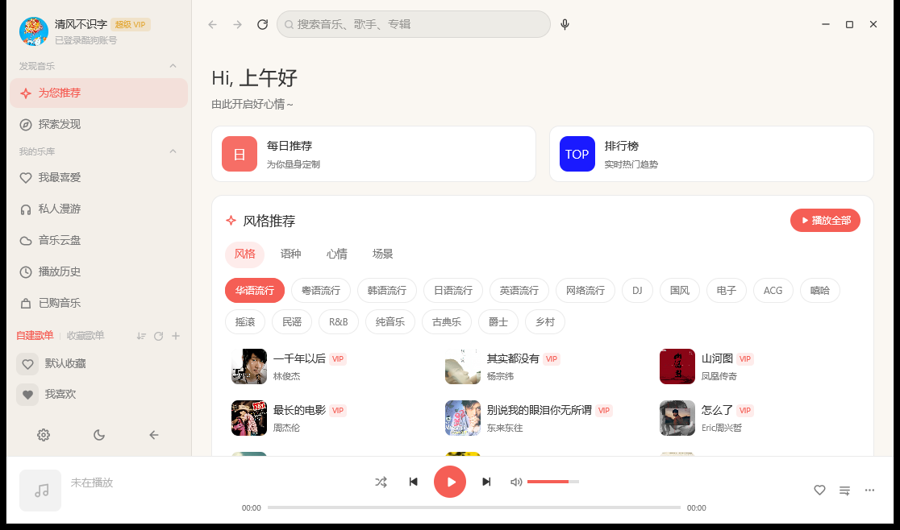
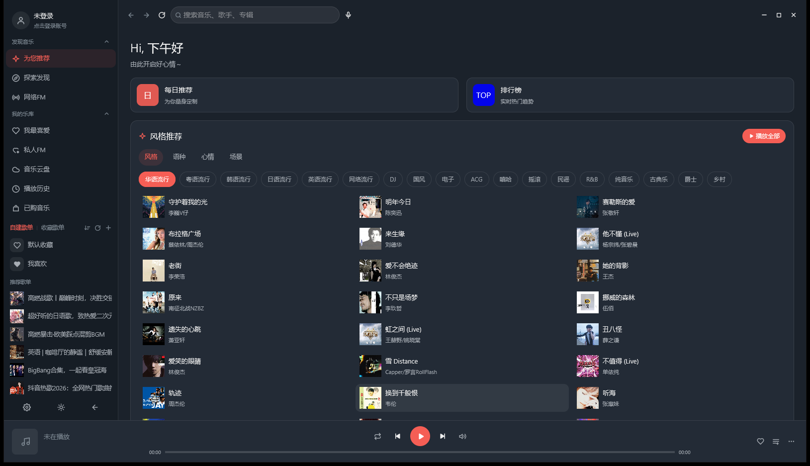

# EchoMusic（Rust + GPUI 重写）

[EchoMusic](https://github.com/hoowhoami/EchoMusic)（Electron + Vue 3 + TS）的 Rust 重写版本，UI 使用 [GPUI](https://github.com/zed-industries/zed/tree/main/crates/gpui) 0.2.2 自绘。

当前进度：**第二期已完成**（登录 / 每日推荐 / 排行榜 / 探索 / 歌手·专辑 / 收藏 / 历史 / 设置 / 个人中心），并完成一轮 UI 修复。
功能清单与三期计划见 [`docs/plan.md`](docs/plan.md)。

## 截图

| 浅色首页 | 深色登录（扫码） |
|---|---|
|  |  |

## 工作区结构

```
crates/
├── echo-core    数据模型、设备身份（mid/guid/dfid）、设置/会话/曲库持久化
├── echo-api     酷狗网关客户端：Android/Web 签名、AES/RSA 加密、各业务接口
├── echo-audio   rodio + symphonia 播放引擎（HTTP 拉取 → 解码 → 输出）
└── echo-app     GPUI 界面：主题、图标、文本输入、布局、页面、播放条
```

## 构建

需要 Rust 1.85+ 与 MSVC 工具链（Windows）。

```bash
# 推荐：通过 build.bat（自动注入 vcvars64 环境，避免 Git Bash 的 link.exe 冲突）
./build.bat build -p echo-app

# 或在 MSVC 开发者命令行里直接
cargo build -p echo-app
```

产物：`target/debug/echo-music.exe`（debug 版带控制台窗口，便于看日志）

### 打包 release 版

```bash
./package.bat      # release 构建 → 复制到 dist\EchoMusic.exe
```

输出：`dist/EchoMusic.exe`（约 26 MB）。该产物不入库，发布时通过 GitHub Release 分发。

release 构建通过 `#![cfg_attr(not(debug_assertions), windows_subsystem = "windows")]`
以 GUI 子系统链接，**启动时不会弹出 cmd 黑窗**（debug 构建保留控制台用于日志）。

> **注意**：全并行 release 编译在本机会卡死（rustc 挂起、CPU 不再增长）。`package.bat` 已固定
> `CARGO_BUILD_JOBS=2`，首次约 6~8 分钟。手动编译请同样限制并行度：
> `CARGO_BUILD_JOBS=2 ./build.bat build --release -p echo-app`

> 国内网络可用 `~/.cargo/config.toml` 配置 rsproxy / 中科大镜像；本项目已在使用。

## 运行

```bash
./target/debug/echo-music.exe
```

自检模式（自动跳转，便于验证链路）：

```bash
ECHO_SMOKE=search          ./target/debug/echo-music.exe   # 搜索「周杰伦」
ECHO_SMOKE=playlist        ./target/debug/echo-music.exe   # 首个推荐歌单
ECHO_SMOKE=login           ./target/debug/echo-music.exe   # 扫码登录
ECHO_SMOKE=login-sms       ./target/debug/echo-music.exe   # 验证码登录
ECHO_SMOKE=login-password  ./target/debug/echo-music.exe   # 账号密码登录
```

窗口截图（开发用）：`powershell -File scripts/shot.ps1 -Name out -Smoke login -HoverX 100 -HoverY 52`

## 接口冒烟

```bash
cargo run -p echo-api --example smoke      # 搜索 → 播放地址
cargo run -p echo-api --example qr_probe   # 扫码 key / 轮询 / 短信验证码接口
cargo run -p echo-api --example debug      # 各接口原始响应
```

## 登录能力

| 方式 | 接口 | 说明 |
|---|---|---|
| 扫码 | `/v2/qrcode` + `/v2/get_userinfo_qrcode`（Web 签名） | 二维码用 `qrcode` crate 生成矩阵，直接 canvas 绘制，3 秒轮询，状态 0/1/2/4 |
| 手机验证码 | `/v7/send_mobile_code` + `/v7/login_by_verifycode` | 概念版 `t1/t2` 指纹，60 秒重发倒计时，`secu_params` 解密 |
| 账号密码 | `/v9/login_by_pwd` | AES-256-CBC + RSA |

登录态写入 `%APPDATA%/EchoMusic/session.json`，启动自动恢复并注入客户端。

## 已实现能力

- **界面**：默认 1100×650 无边框窗口（顶部细条 + 顶栏空白区可拖动）、侧栏按「发现音乐 / 我的乐库 / 自建歌单·收藏歌单」分组（均可折叠）、顶栏（前进/后退/刷新 + 搜索 + 窗口控制）、内容区滚动、底部播放条、Toast
- **主题**：浅色 / 深色色板 + 260ms 平滑过渡动画（sRGB 插值），主题色 `#f55e55`，侧栏底部按钮切换（浅色显示月亮、深色显示太阳），写入 `settings.json`
- **细节**：所有封面 / 缩略图统一 8px 圆角（含侧栏歌单图、探索网格），头像圆形，输入框整框可点即输入，光标颜色跟随主题
- **首页**：问候语、每日推荐 / 排行榜快捷卡、风格推荐（分类 Tab + 多选标签 + 歌曲网格）、推荐歌单、编辑精选
- **探索 / 排行榜 / 每日推荐 / 私人漫游 / 歌手 / 专辑 / 榜单详情 / 收藏 / 历史 / 设置 / 个人中心**
- **搜索**：单曲 / 歌单 / 歌手 / 专辑 四分类；**歌单详情**含评论列表
- **VIP 标识**：歌曲按 `privilege` 显示 `VIP / 付费 / 版权 / 音源` 标签；用户账号显示 `VIP / 超级 VIP / 黑胶 VIP` 金色标签
- **我最喜爱**：登录后从酷狗云歌单「我喜欢」读取（实测 800+ 首），红心按钮直接增删云歌单
- **播放条**：可拖动进度条（拖拽 seek）、可拖动音量条 + 静音切换、播放队列浮层面板（点击切歌）
- **数据**：设备注册、Android 签名（标准 / lite 双套盐值）+ Web 签名、Cookie 与 `x-router` 路由、响应 JSON 注释清洗
- **播放**：队列、播放模式（顺序/列表/随机/单曲）、进度上报、自动下一首、seek、音量

## 已知限制

- **播放地址**：非 VIP 歌曲未登录也能播（走免签名 CDN `/i/?cmd=4`，128k mp3）；VIP / 付费歌曲登录后走「设备注册 → user_verify → authorization → tracker/v5/url」授权链，可正常播放。
- 音乐云盘 / 已购音乐 / 歌单创建仍需额外加密流程，暂为占位（第三期）。
- 私人 FM（`/v1/app_song_list_offset` 返回 20006）、搜索六类分页（`/v6/search/complex` 返回 152）、云盘 / 已购 / 歌单管理 / 评论 UI 仍在第三期计划中。
- `/v3/get_list_info` 偶发 `20028`，已用推荐列表元信息兜底，曲目接口正常。

## 数据目录

`%APPDATA%/EchoMusic/`

| 文件 | 说明 |
|---|---|
| `device.json` | 设备身份（mid / guid / uuid / dfid / webgl） |
| `settings.json` | 主题模式、主题色、音量、播放模式、音质等 |
| `session.json` | 登录态（token / userid / 昵称 / 头像 / VIP） |
| `library.json` | 收藏与播放历史 |

## 环境与前置

- Windows（当前仅适配 Windows；`echo-audio` 用 rodio，理论上可跨平台，但 UI 与构建脚本尚未验证其他平台）
- Rust 1.85+ 与 **MSVC x64 工具链**（VS2022 生成工具 + Windows 10/11 SDK）
- `build.bat` 里写死了本机的 MSVC / SDK 路径（MSVC `14.44.35207`、SDK `10.0.26100.0`）。
  若你的版本号不同，改这三行即可（在「VS Installer → 各个组件」或 `C:\Program Files\Microsoft Visual Studio\2022\*\VC\Tools\MSVC\` 下确认实际版本）：

  ```bat
  set "MSVC_ROOT=...\VC\Tools\MSVC\<你的版本>"
  set "SDK_ROOT=C:\Program Files (x86)\Windows Kits\10"
  set "LIB=%MSVC_ROOT%\lib\x64;%SDK_ROOT%\Lib\<你的 SDK 版本>\ucrt\x64;..."
  ```

- 不要用 MSYS2 / Git Bash 的 `link.exe`（会与 MSVC 冲突）。`build.bat` 已把 MSVC 的 `bin\Hostx64\x64` 前置到 PATH 规避此问题。

## 参考与致谢

- [hoowhoami/EchoMusic](https://github.com/hoowhoami/EchoMusic) —— 本项目的原型（Electron + Vue 3 + TS），交互与视觉设计对齐它
- [KuGouMusicApi](https://github.com/ku-gou/KuGouMusicApi) —— 接口签名与加密方案的参考实现
- [GPUI](https://github.com/zed-industries/zed)（Zed 编辑器的 UI 框架）—— 本项目全部界面自绘基于它
- rodio / symphonia / reqwest / qrcode 等 crate

> 参考代码（原型与 KuGouMusicApi）**不包含在本仓库中**，请到各自原仓库查看，并遵守它们的许可协议。

## 免责声明

本项目是个人学习用途的桌面客户端实现，与酷狗音乐官方无任何关联，不使用任何官方 SDK 或授权接口。
所涉及的接口调用均为对客户端已有公开行为的复现，**请勿用于任何商业或违法用途**。
音乐版权归各自权利人所有，本项目不存储、不分发任何音频文件。

## 许可

尚未选择开源许可证，默认**保留所有权利**（即 GitHub 的默认状态，他人不可复制、分发或修改）。
如果你希望开源，可自行添加 `LICENSE` 文件（如 MIT）并在此处注明。
